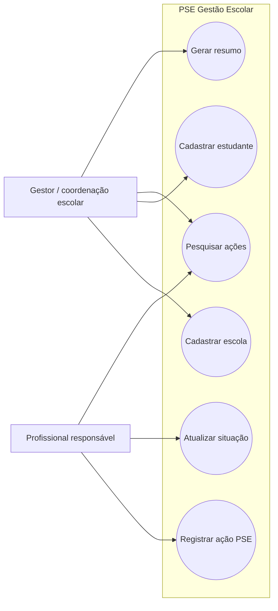

# Casos de uso

## Atores

- **Gestor/coordenação escolar:** cadastra e consulta escolas e estudantes, pesquisa ações e acompanha resumos.
- **Profissional responsável pela ação:** registra ações e atualiza a situação.
- **Equipe de desenvolvimento/testes:** constrói e valida a aplicação; ator de suporte, não usuário operacional do sistema.

## Diagrama

## UC01 — Cadastrar escola

- **Objetivo:** registrar uma escola para vincular estudantes e ações.
- **Pré-condições:** aplicação iniciada; capacidade disponível.
- **Fluxo principal:** usuário seleciona cadastro de escola; informa nome e município; sistema valida campos e duplicidade; atribui código; persiste e confirma.
- **Alternativos:** campo vazio/reservado ou duplicidade: informa erro e não grava; limite de 100: recusa novo cadastro; falha de arquivo: informa falha de persistência.
- **Pós-condição:** escola registrada com código persistente.

## UC02 — Cadastrar estudante

- **Objetivo:** guardar identificação mínima do estudante e vínculo escolar.
- **Pré-condições:** escola existente e capacidade disponível.
- **Fluxo principal:** usuário seleciona cadastro; escolhe código da escola; informa nome e idade; sistema valida, verifica duplicidade por nome e escola, atribui código e persiste.
- **Alternativos:** sem escola cadastrada, escola inexistente, idade fora de 4–25, dado inválido, duplicidade ou limite atingido: informa e não grava.
- **Pós-condição:** estudante fica vinculado à escola informada. Nenhum dado clínico é armazenado.

## UC03 — Registrar ação do PSE

- **Objetivo:** registrar atividade planejada para uma escola.
- **Pré-condições:** escola existente e capacidade disponível.
- **Fluxo principal:** usuário seleciona registro; informa escola, tema, data e responsável; sistema valida; atribui código, define `Planejada` e persiste.
- **Alternativos:** escola inexistente, campos inválidos, data malformada ou limite atingido: informa e não grava.
- **Pós-condição:** ação disponível para pesquisa e resumo.

## UC04 — Pesquisar ações

- **Objetivo:** localizar ações cadastradas.
- **Pré-condições:** aplicação iniciada; para resultado, deve haver ação compatível.
- **Fluxo principal:** usuário escolhe filtro (código, escola, tema, ano ou situação) ou listagem completa; informa termo quando solicitado; sistema apresenta ações correspondentes.
- **Alternativos:** termo inválido ou nenhuma correspondência: sistema informa e retorna ao menu.
- **Pós-condição:** dados exibidos sem alteração.

## UC05 — Atualizar situação

- **Objetivo:** refletir progresso ou cancelamento da ação.
- **Pré-condições:** ação existente.
- **Fluxo principal:** usuário informa código; sistema exibe situação atual; usuário escolhe Planejada, Em andamento, Concluída ou Cancelada; sistema salva e confirma.
- **Alternativos:** código inexistente ou opção inválida: sistema informa; registro permanece inalterado.
- **Pós-condição:** situação escolhida persiste no arquivo de ações.

## UC06 — Gerar resumo

- **Objetivo:** consolidar contagens para acompanhamento administrativo.
- **Pré-condições:** aplicação iniciada.
- **Fluxo principal:** usuário seleciona resumo; sistema contabiliza totais gerais, ações por situação e ações por escola.
- **Alternativos:** base vazia: apresenta contagens iguais a zero.
- **Pós-condição:** resumo exibido; dados não são alterados.
